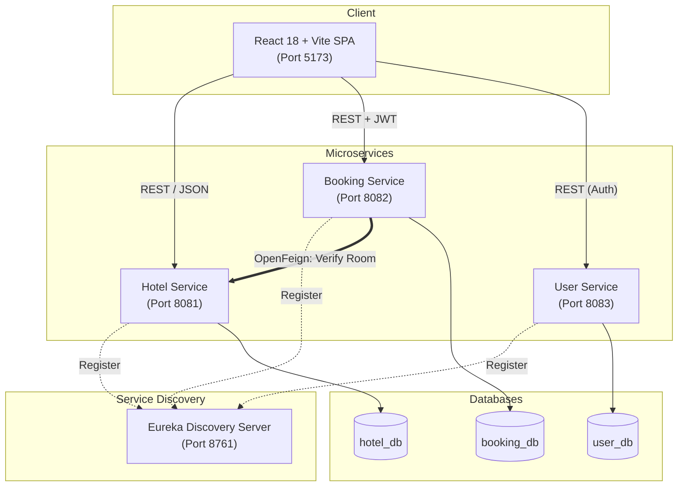

# GrandStay – Hotel Booking Management System

A full-stack hotel booking platform built on a distributed **Spring Boot microservices** architecture with a modern **React (Vite)** single-page application.

[](https://www.oracle.com/java/)
[](https://spring.io/projects/spring-boot)
[](https://spring.io/projects/spring-cloud)
[](https://react.dev/)
[](https://vitejs.dev/)
[](https://www.mysql.com/)
[](#testing--verification)

---

## Table of Contents

- [Overview](#overview)
- [Key Features](#key-features)
- [Architecture & Tech Stack](#architecture--tech-stack)
- [Project Structure](#project-structure)
- [Database Configuration](#database-configuration)
- [Prerequisites](#prerequisites)
- [Environment Configuration](#environment-configuration)
- [Getting Started](#getting-started)
  - [1. Database Setup](#1-database-setup)
  - [2. Starting Backend Services](#2-starting-backend-services)
  - [3. Starting Frontend](#3-starting-frontend)
- [Service URLs & Ports](#service-urls--ports)
- [API Reference](#api-reference)
- [Security & Authentication](#security--authentication)
- [Booking Workflow & Business Logic](#booking-workflow--business-logic)
- [Testing & Verification](#testing--verification)

---

## Overview

**GrandStay** provides an end-to-end hotel room discovery and booking experience. The system is architected as loosely coupled, independently scalable microservices coordinated by **Netflix Eureka** service discovery and communicating via **Spring Cloud OpenFeign**.

Security is enforced using stateless **JSON Web Tokens (JWT)** and **BCrypt** password hashing, with server-side ownership authorization protecting user reservations.

---

## Key Features

- **Hotel & Room Catalog**: Browse hotels, view amenities, inspect room types (`SINGLE`, `DOUBLE`, `SUITE`, `DELUXE`), prices per night, and capacity.
- **Dynamic Availability & Pricing**: Real-time room availability validation preventing overlapping reservations, with automatic total price calculation based on booking duration.
- **Booking Management**: Authenticated reservation creation, personal booking history ("My Bookings"), and one-click booking cancellation.
- **Instant Date Re-Booking**: Cancelling a reservation immediately frees the date window for other guests.
- **Secure Authentication**: User registration with input validation, duplicate email detection, BCrypt credential hashing, and 24-hour HMAC-SHA256 JWT tokens.
- **Server-Side Authorization**: Complete protection against ID spoofing; users can only view and cancel their own reservations.
- **Responsive Web UI**: Built with React, Vite, and custom CSS design system supporting desktop, tablet, and mobile with an accessible hamburger navigation drawer.

---

## Architecture & Tech Stack



> For full architectural details, sequence diagrams, and Feign client specifications, see [System Architecture Documentation](docs/ARCHITECTURE.md).

### Technologies Implemented

| Layer | Technologies |
| :--- | :--- |
| **Backend Framework** | Java 21, Spring Boot 4.1.2, Spring Cloud 2025.1.4 |
| **Service Discovery** | Spring Cloud Netflix Eureka Server & Client |
| **Inter-Service Client** | Spring Cloud OpenFeign |
| **Security & Auth** | Spring Security 7.1.2, JJWT 0.12.6, BCrypt Password Encoder |
| **Persistence** | Spring Data JPA, Hibernate, MySQL Connector/J |
| **Databases** | MySQL (3 isolated service schemas) |
| **Frontend** | React 18.3.1, Vite 6.4.6, React Router DOM 6.28.0, Axios 1.7.9 |
| **Styling** | Modern CSS Design System (Custom properties, CSS Grid, Flexbox) |
| **Testing** | JUnit 5, Mockito, Spring Boot Test, MockMvc |

---

## Project Structure

```
hotel-booking-management-system/
├── .env.example                     # Backend environment variables template
├── docs/
│   └── ARCHITECTURE.md              # In-depth architectural design & diagrams
├── backend/
│   ├── eureka-server/               # Service discovery registry (Port 8761)
│   ├── hotel-service/               # Hotel & room inventory catalog (Port 8081)
│   ├── booking-service/             # Bookings & availability service (Port 8082)
│   └── user-service/                # Auth, JWT & user profile service (Port 8083)
└── frontend/                        # React + Vite single page application (Port 5173)
    ├── .env.example                 # Frontend API URLs template
    ├── package.json
    ├── vite.config.js
    └── src/
        ├── components/              # Navbar, Footer, ProtectedRoute, Hero, etc.
        ├── context/                 # AuthContext (JWT session state)
        ├── pages/                   # HomePage, HotelsPage, HotelDetailsPage,
        │                            # LoginPage, RegisterPage, MyBookingsPage
        ├── routes/                  # AppRoutes configuration
        ├── services/                # Axios API clients (hotel, booking, user)
        ├── styles/                  # Responsive CSS design system
        └── utils/                   # Currency formatters & date helpers
```

---

## Database Configuration

The system uses dedicated MySQL databases for each microservice to maintain database-per-service isolation:

| Service | Database Name | Description |
| :--- | :--- | :--- |
| **Hotel Service** | `hotel_db` | Hotels and room inventory records |
| **Booking Service** | `booking_db` | Reservation records and booking statuses |
| **User Service** | `user_db` | User accounts, hashed passwords, roles |

Each service utilizes `createDatabaseIfNotExist=true` and `spring.jpa.hibernate.ddl-auto=update` to automatically initialize and synchronize schemas upon startup.

---

## Prerequisites

Ensure you have the following installed locally:
- **Java Development Kit (JDK)**: Version 21 or higher
- **Apache Maven**: Version 3.9 or higher
- **Node.js**: Version 18.x or higher (with `npm`)
- **MySQL Server**: Version 8.0 or compatible MySQL server

---

## Environment Configuration

### 1. Backend Environment Variables
Configure your environment using the provided [.env.example](.env.example) template:

| Variable | Description | Default |
| :--- | :--- | :--- |
| `DB_HOST` | MySQL hostname | `localhost` |
| `DB_PORT` | MySQL port | `3306` |
| `DB_USERNAME` | MySQL user | `root` |
| `DB_PASSWORD` | MySQL password | *(empty)* |
| `JWT_SECRET` | HMAC-SHA256 secret key (minimum 32 characters) | *Required for User & Booking Services* |

#### Setting `JWT_SECRET` in Shell:
```bash
# Linux / macOS
export JWT_SECRET="your_secure_256_bit_secret_key_at_least_32_characters_long"

# Windows (PowerShell)
$env:JWT_SECRET="your_secure_256_bit_secret_key_at_least_32_characters_long"
```

### 2. Frontend Environment Variables
In the `frontend/` directory, copy `.env.example` to `.env`:
```bash
cd frontend
cp .env.example .env
```
Default values connect to local backend services:
```env
VITE_HOTEL_SERVICE_URL=http://localhost:8081
VITE_BOOKING_SERVICE_URL=http://localhost:8082
VITE_USER_SERVICE_URL=http://localhost:8083
```

---

## Getting Started

Follow these steps in order to start the platform.

### 1. Database Setup
Start your local MySQL service:
```bash
# Windows
net start MySQL80

# Linux
sudo systemctl start mysql

# macOS
brew services start mysql
```

### 2. Starting Backend Services
Open separate terminal tabs for each service and start them in the specified sequence:

#### Step 2.1: Eureka Discovery Server (Port 8761)
```bash
cd backend/eureka-server
mvn spring-boot:run
```
*Wait until Eureka starts (accessible at `http://localhost:8761`).*

#### Step 2.2: Hotel Service (Port 8081)
```bash
cd backend/hotel-service
mvn spring-boot:run
```

#### Step 2.3: User Service (Port 8083)
```bash
cd backend/user-service
mvn spring-boot:run
```

#### Step 2.4: Booking Service (Port 8082)
```bash
cd backend/booking-service
mvn spring-boot:run
```

*Confirm in the Eureka dashboard (`http://localhost:8761`) that `HOTEL-SERVICE`, `USER-SERVICE`, and `BOOKING-SERVICE` report status **UP**.*

### 3. Starting Frontend
Open a new terminal tab:
```bash
cd frontend
npm install
npm run dev
```
Open your browser to **`http://localhost:5173`**.

---

## Service URLs & Ports

| Component | URL | Port |
| :--- | :--- | :--- |
| **React Frontend** | `http://localhost:5173` | `5173` |
| **Eureka Discovery Dashboard** | `http://localhost:8761` | `8761` |
| **Hotel Service** | `http://localhost:8081` | `8081` |
| **Booking Service** | `http://localhost:8082` | `8082` |
| **User Service** | `http://localhost:8083` | `8083` |
| **MySQL Server** | `localhost:3306` | `3306` |

---

## API Reference

### User Service (`http://localhost:8083`)
| Method | Endpoint | Access | Description |
| :--- | :--- | :--- | :--- |
| `POST` | `/api/auth/register` | Public | Register new user account (`name`, `email`, `password`) |
| `POST` | `/api/auth/login` | Public | Authenticate credentials; returns JWT token & user info |
| `GET` | `/api/users/me` | Authenticated | Retrieve authenticated user profile |

### Hotel Service (`http://localhost:8081`)
| Method | Endpoint | Access | Description |
| :--- | :--- | :--- | :--- |
| `GET` | `/api/hotels` | Public | List all hotels with amenities and ratings |
| `GET` | `/api/hotels/{id}` | Public | Get hotel details including available rooms |
| `POST` | `/api/hotels` | Public / Admin | Create a new hotel |
| `PUT` | `/api/hotels/{id}` | Public / Admin | Update hotel details |
| `DELETE`| `/api/hotels/{id}` | Public / Admin | Remove a hotel |
| `GET` | `/api/hotels/{hotelId}/rooms` | Public / Feign | Get all rooms for a hotel |
| `POST` | `/api/hotels/{hotelId}/rooms` | Public / Admin | Add a new room to a hotel |

### Booking Service (`http://localhost:8082`)
| Method | Endpoint | Access | Description |
| :--- | :--- | :--- | :--- |
| `POST` | `/api/bookings` | Authenticated | Create booking (`hotelId`, `roomId`, `checkInDate`, `checkOutDate`) |
| `GET` | `/api/bookings/{id}` | Authenticated (Owner/Admin) | Get booking details by ID |
| `GET` | `/api/bookings/user/{userId}` | Authenticated (Owner/Admin) | List all bookings for a user |
| `PUT` | `/api/bookings/{id}/cancel` | Authenticated (Owner/Admin) | Cancel a confirmed booking |

---

## Security & Authentication

GrandStay follows defense-in-depth security best practices:

1. **Stateless JWT Verification**: User Service issues signed HMAC-SHA256 tokens valid for 24 hours. The Booking Service validates token authenticity on every request through its `JwtAuthenticationFilter`.
2. **Password Security**: Plaintext passwords are never logged or stored. Credentials are encrypted using `BCryptPasswordEncoder`.
3. **Identity Spoofing Prevention**: On booking creation (`POST /api/bookings`), the backend strictly enforces the user ID from the verified JWT token (`user.getUserId()`), ignoring any `userId` passed in the request body.
4. **Ownership Authorization**: Normal users are restricted to their own reservations:
   - Requesting another user's bookings returns **HTTP 403 Forbidden**.
   - Attempting to cancel another user's booking returns **HTTP 403 Forbidden**.
5. **Route Protection**: The React application guards private pages via `ProtectedRoute.jsx`, automatically redirecting unauthenticated users to `/login` while preserving their return location state.

---

## Booking Workflow & Business Logic

The reservation lifecycle adheres to strict verification rules:

```
[User Selects Room & Dates]
           │
           ▼
[Date Validation] ─── Check-in >= Check-out? ──► [HTTP 400 Bad Request]
           │ Valid
           ▼
[OpenFeign Lookup] ── Hotel/Room Missing or Inactive? ──► [HTTP 404 / 400]
           │ Verified
           ▼
[Overlap Check] ── Existing CONFIRMED Overlap? ──► [HTTP 409 Conflict]
           │ Available
           ▼
[Price Calculation] (Nights × Rate per Night)
           │
           ▼
[Persist Booking] (Status: CONFIRMED) ──► [HTTP 201 Created]
           │
           ▼
[Cancellation] (Status -> CANCELLED) ──► Dates Released for New Bookings
```

1. **Date Validation**: Ensures both dates are non-null and `checkInDate` is strictly prior to `checkOutDate`.
2. **Room Verification via OpenFeign**: Queries the Hotel Service over Eureka to ensure the room exists and `isAvailable == true`.
3. **Overlap Prevention**: Queries `booking_db` for existing `CONFIRMED` bookings overlapping the requested date window (`checkInDate < existing.checkOutDate AND checkOutDate > existing.checkInDate`).
4. **Price Calculation**: Computes `totalPrice = room.pricePerNight * daysBetween(checkInDate, checkOutDate)`.
5. **Cancellation & Unblocking**: When a user cancels a booking, its status transitions to `CANCELLED`. Subsequent overlap queries exclude cancelled bookings, instantly reopening the date range.

---

## Testing & Verification

The application features comprehensive automated unit, integration, and security test suites across all services.

### Running Backend Tests
Execute Maven tests in each service directory:
```bash
cd backend/eureka-server && mvn test
cd ../hotel-service && mvn test
cd ../booking-service && mvn test
cd ../user-service && mvn test
```

#### Test Suite Summary:
- **`eureka-server`**: 1 test (Context load & registration bootstrap)
- **`hotel-service`**: 23 tests (Controller slice tests, JPA repository tests, CORS tests, service business logic)
- **`booking-service`**: 41 tests (JWT security tests, ownership authorization, Feign integration, date overlap prevention, pricing logic)
- **`user-service`**: 25 tests (Registration validation, duplicate email detection, BCrypt auth, JWT token parsing, security rules)
- **Total Backend Tests: 90 / 90 Passing (100% Pass Rate)**

### Running Frontend Production Build
Validate the client application bundle:
```bash
cd frontend
npm run build
```
*Builds cleanly in under 2 seconds with 0 warnings or errors.*
