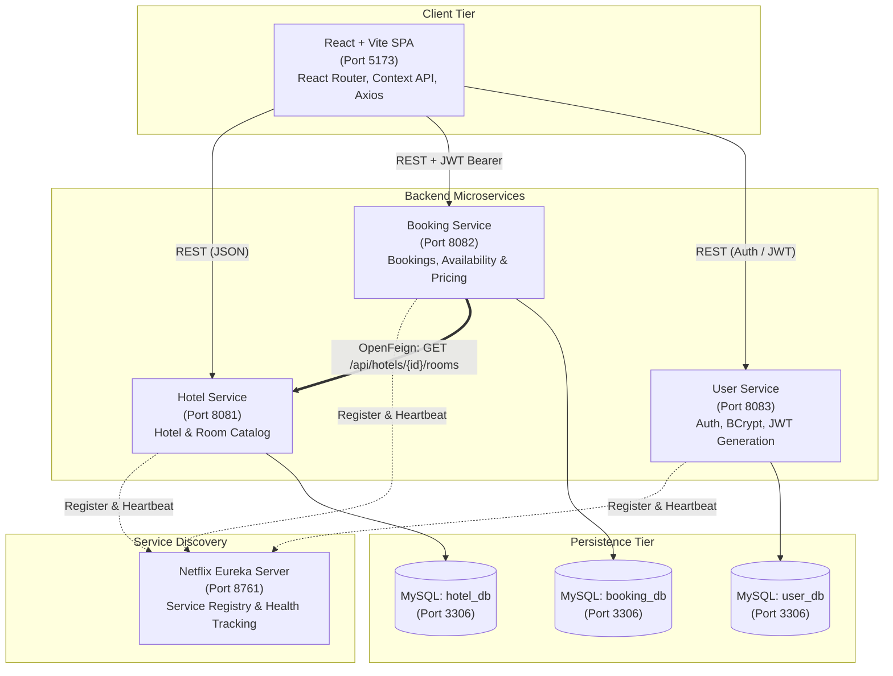
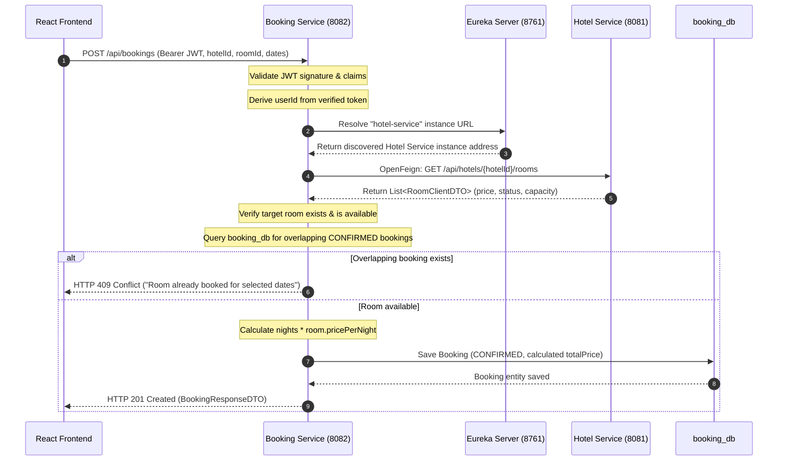
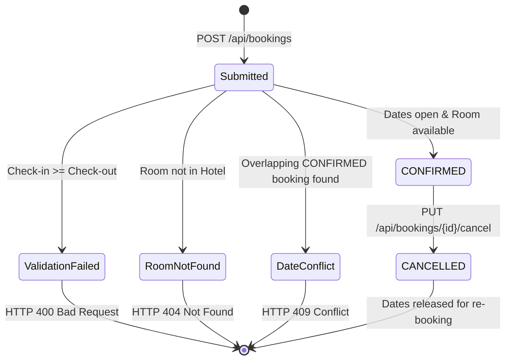

# GrandStay – System Architecture & Technical Design

This document details the microservices architecture, data flow, inter-service communication, security model, and request lifecycles of the **GrandStay Hotel Booking Management System**.

---

## 1. High-Level Architecture Overview

GrandStay is designed as a distributed, decoupled microservices architecture with a dedicated client-side Single Page Application (SPA).



---

## 2. Component Breakdown

### A. React Frontend (`frontend/` – Port 5173)
* **Framework**: React 18, bundled with Vite 6.
* **Routing**: React Router DOM v6 with declarative routing and `ProtectedRoute` guards.
* **State Management**: `AuthContext` provides centralized authentication state (`currentUser`, `token`, `isAuthenticated`, `login`, `logout`) backed by `localStorage` persistence.
* **HTTP Client**: Axios instances configured with 8-second timeouts and automatic request interceptors injecting the `Authorization: Bearer <token>` header.
* **Responsive Layout**: Pure CSS design system with mobile navigation drawer, fluid grids, and accessibility attributes (`aria-expanded`, `aria-label`).

### B. Eureka Discovery Server (`backend/eureka-server/` – Port 8761)
* **Framework**: Spring Cloud Netflix Eureka Server (`@EnableEurekaServer`).
* **Role**: Centralized service registry. Enables microservices to discover and communicate with each other dynamically by service name (`hotel-service`, `booking-service`, `USER-SERVICE`) without hardcoded hostnames or ports.

### C. Hotel Service (`backend/hotel-service/` – Port 8081)
* **Framework**: Spring Boot 4.1.2, Spring Data JPA, Hibernate, MySQL Connector/J.
* **Database**: `hotel_db`
* **Responsibilities**:
  * Hotel catalog management (CRUD operations on hotels).
  * Room inventory management (types: `SINGLE`, `DOUBLE`, `SUITE`, `DELUXE`; base price; capacity; availability flag).
  * Public catalog endpoints consumed by the React frontend and internal endpoints consumed by Booking Service via OpenFeign.

### D. Booking Service (`backend/booking-service/` – Port 8082)
* **Framework**: Spring Boot 4.1.2, Spring Cloud OpenFeign, Spring Security, JJWT 0.12.6, Spring Data JPA, MySQL Connector/J.
* **Database**: `booking_db`
* **Responsibilities**:
  * Reservation creation, tracking, and cancellation.
  * Room availability verification and overlapping booking prevention.
  * Real-time total price calculation based on room rate and number of nights.
  * Stateless JWT validation and server-side ownership authorization.

### E. User Service (`backend/user-service/` – Port 8083)
* **Framework**: Spring Boot 4.1.2, Spring Security, BCrypt (`BCryptPasswordEncoder`), JJWT 0.12.6, Spring Data JPA, MySQL Connector/J.
* **Database**: `user_db`
* **Responsibilities**:
  * User registration with validation and unique email enforcement.
  * Secure credential authentication with BCrypt hash verification.
  * JWT generation with 24-hour expiration containing `userId`, `email`, and `role`.
  * Authenticated user profile lookup (`GET /api/users/me`).

---

## 3. Inter-Service Communication (OpenFeign)

When a client initiates a booking request, the **Booking Service** must verify room pricing, room existence, and base availability directly with the **Hotel Service**.



### Feign Client Definition
```java
@FeignClient(name = "hotel-service")
public interface HotelServiceClient {
    @GetMapping("/api/hotels/{hotelId}/rooms")
    List<RoomClientDTO> getRoomsByHotelId(@PathVariable("hotelId") Long hotelId);
}
```

---

## 4. Security & Authentication Architecture

GrandStay implements **stateless token-based security** with end-to-end authorization enforcement:

```mermaid
graph TD
    subgraph 1. Registration Flow
        RegUser[User] -->|"POST /api/auth/register<br/>(name, email, password)"| RegController[User Service]
        RegController -->|"Hash password"| BCryptHash[BCrypt Encoder]
        BCryptHash -->|"Persist user record"| UserDB1[(user_db)]
        UserDB1 -->|"Saved user"| RegController
        RegController -->>|"HTTP 201 Created<br/>UserResponseDTO (No JWT)"| RegUser
    end

    subgraph 2. Login Flow
        LoginUser[User] -->|"POST /api/auth/login<br/>(email, password)"| AuthController[User Service]
        AuthController -->|"Load user & verify password"| BCryptVerify[BCrypt.matches()]
        BCryptVerify -->|"Generate token (24h)"| JwtGen[JwtUtil]
        JwtGen -->|"HTTP 200 OK<br/>LoginResponseDTO (JWT + User Profile)"| LoginUser
    end

    subgraph 3. Secure Booking Request Flow
        BookUser[User] -->|"POST /api/bookings<br/>Authorization: Bearer &lt;JWT&gt;"| BookingFilter[Booking Service]
        BookingFilter -->|"Extract & Validate Signature"| JwtVal[JwtAuthenticationFilter]
        JwtVal -->|"Populate Principal"| SecCtx[SecurityContextHolder]
        SecCtx -->|"Enforce Ownership: userId = token.userId"| BookingCtrl[BookingController]
    end
```

### Key Security Guardrails:
1. **Shared Secret Strategy**: User Service and Booking Service share a HMAC-SHA256 signing secret configured via the `JWT_SECRET` environment variable.
2. **Stateless Sessions**: Neither service maintains HTTP sessions (`SessionCreationPolicy.STATELESS`). Every request is authenticated on the fly.
3. **No Frontend Spoofing**: In `BookingController.createBooking()`, the `userId` in the request body is intentionally overwritten by `user.getUserId()` extracted from the validated token.
4. **Ownership Protection**:
   * Viewing an individual booking (`GET /api/bookings/{id}`): Rejected with **HTTP 403 Forbidden** if `booking.userId != user.userId` (unless the user has `ROLE_ADMIN`).
   * Listing a user's bookings (`GET /api/bookings/user/{userId}`): Rejected with **HTTP 403 Forbidden** if requested `userId != user.userId`.
   * Cancelling a booking (`PUT /api/bookings/{id}/cancel`): Rejected with **HTTP 403 Forbidden** if `booking.userId != user.userId`.
5. **CORS Hardening**: Explicit CORS policies configured on all microservices to allow origins (`http://localhost:5173`) and methods (`GET`, `POST`, `PUT`, `DELETE`, `OPTIONS`) while honoring standard preflight requests.

---

## 5. Booking Availability & Cancellation State Machine



### Overlap Detection Query
The Booking Service performs application-level overlap validation against existing `CONFIRMED` bookings using a JPQL query in `BookingRepository` prior to persisting a new reservation:
```jpql
SELECT COUNT(b) > 0 FROM Booking b
WHERE b.roomId = :roomId
  AND b.bookingStatus = :status
  AND b.checkInDate < :checkOutDate
  AND b.checkOutDate > :checkInDate
```

> **Note on Concurrency**: Overlap checking is performed at the application service level in `BookingServiceImpl.createBooking()`. The current implementation does not implement database-level exclusion constraints or pessimistic/optimistic locking for concurrent submissions on the exact same room and dates.

When a booking is cancelled, its status changes to `CANCELLED`. Subsequent overlap queries filter specifically by `bookingStatus = 'CONFIRMED'`, excluding `CANCELLED` bookings and immediately releasing the date range for new reservations.
